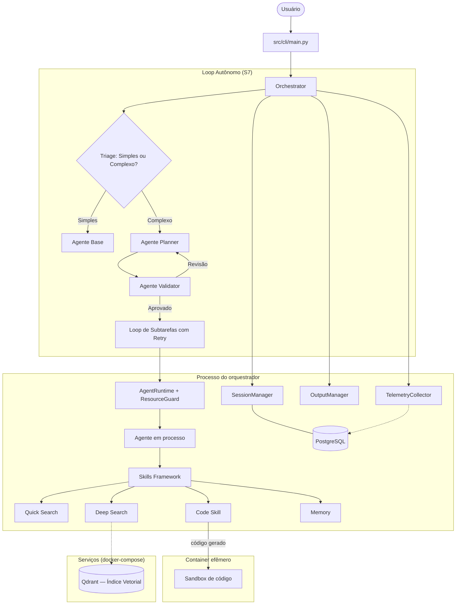

# 🔮 GeminiClaw

**GeminiClaw** é um framework de orquestração de agentes de IA projetado para rodar em hardware local de baixo recurso computacional (**Raspberry Pi 5**) com provedores LLM agnósticos (**Google Gemini**, **Anthropic Claude**, **OpenAI** e **Ollama** local) e **Docker** apenas para isolar a execução de código.

O projeto permite que múltiplos agentes especializados colaborem em tarefas complexas via um loop de **raciocínio autônomo**, garantindo segurança, persistência de estado e uso eficiente de recursos.

---

## 📋 Índice

- [Instalação e Modos](#-instalação-e-modos)
- [Arquitetura](#-arquitetura)
- [Componentes Principais](#componentes-principais)
- [Skills Framework](#-skills-framework)
- [Raciocínio e Planejamento](#-raciocínio-e-planejamento)
- [Loop Autônomo](#-loop-de-execução-autônoma)
- [Agentes Especializados](#-agentes-especializados)
- [Comunicação (IPC)](#-comunicação-ipc)
- [Infraestrutura Docker](#-infraestrutura-docker)
- [Como testar](#-como-testar)
- [Status do Desenvolvimento](#-status-do-desenvolvimento)

---

## 🚀 Instalação e Modos

O GeminiClaw pode ser configurado em diferentes modos dependendo do hardware disponível.

### 1. Modo Local (Recomendado para Pi 5)
Usa **Ollama** para inferência local e não requer internet para o LLM.
```bash
# Instalação
uv sync
cp .env.example .env

# Configuração .env (política padrão: self_hosted_only; o catálogo escolhe o modelo Ollama)
LLM_DATA_POLICY=self_hosted_only
RESEARCHER_MODEL=ollama/qwen3.5:4b   # opcional: pin provedor/modelo
AGENT_TIMEOUT_SECONDS=0   # sem tempo limite (inferência local lenta)
LLM_PROVIDER_PRIORITY=ollama,openai_compatible,google,anthropic,openai   # provedores locais primeiro
TEMPERATURE_LIMIT=75   # proteção térmica (°C); sem valor, a temperatura não é verificada
```

Veja o [guia de configuração do Ollama no Pi 5](OLLAMA_PI5.md) para detalhes de otimização e instalação.

### 2. Modo Cloud (Fallback)
Usa **Google Gemini API** para maior inteligência.
```bash
# Instalação
uv sync --extra google
cp .env.example .env

# Configuração .env (prompts com dados do projeto saem do host: declare a política explicitamente)
LLM_DATA_POLICY=third_party_allowed
GEMINI_API_KEY=sua_chave_aqui
```

---

## 🏗️ Arquitetura

O sistema utiliza uma abordagem de **Multi-Agent Systems (MAS)** onde um **Orchestrator** central coordena o planejamento e a execução, delegando tarefas para agentes que rodam **no próprio processo do orquestrador** (`AgentRuntime`, ADR 014). O único container de execução é o **sandbox de código**, usado pela skill de código para rodar o que o LLM gera. Um **loop autônomo** decide se a tarefa é simples (resolvida pelo agente base diretamente) ou complexa (decomposta via Planner → Validator → execução sequencial).



### Componentes Principais

| Componente | Módulo | Função |
| --- | --- | --- |
| **Orchestrator** | `src/orchestration/orchestrator.py` | Coordena o loop de planejamento e a execução sequencial de agentes. Integra o `AutonomousLoop`. Instrumentado com telemetria V5.6. |
| **AutonomousLoop** | `src/orchestration/autonomous_loop.py` | Triage (simples/complexo), decomposição via Planner→Validator, loop de retentativas por subtarefa. Instrumentado com telemetria V5.8. |
| **AgentRuntime** | `src/agent_runtime/runtime.py` | Executa cada agente no processo do orquestrador, com contexto por tarefa (`contextvars`), timeout (`AGENT_TIMEOUT_SECONDS`) e isolamento de falhas: uma exceção vira `AgentResult` de erro e nunca derruba a sessão. |
| **ResourceGuard** | `src/agent_runtime/resources.py` | Limita quantos agentes rodam ao mesmo tempo (pela RAM livre, teto `MAX_CONCURRENT_AGENTS`), reserva uma vaga extra para inferência local (`MAX_LOCAL_LLM_CONCURRENT`) e espera a temperatura e a memória do Pi voltarem ao normal. |
| **Infraestrutura** | `src/cli/infrastructure.py` | Na partida, confere se PostgreSQL, Qdrant e o daemon de containers (só para o sandbox) respondem. |
| **SessionManager** | `src/session/manager.py` | Persistência de histórico e estado em **PostgreSQL**. |
| **OutputManager** | `src/artifacts/output_manager.py` | Gerencia artefatos produzidos e compartilhamento de arquivos entre agentes via `outputs/<session_id>/<task>/`. |
| **TelemetryCollector** | `src/observability/telemetry.py` | Coleta e persiste métricas de execução (agent_events, tool_usage, token_usage, hardware_snapshots) em batch no PostgreSQL. Fornece estatísticas sintetizadas para o Summarizer. |
| **SkillRegistry** | `src/skills/__init__.py` | Registro dinâmico que converte skills Python em ferramentas compatíveis com o formato de tool calling dos provedores LLM. |
| **CLI** | `src/cli/main.py` | Interface de linha de comando com modo direto, REPL interativo e subcomandos `--metrics`, `--export`. |

---

## 🛠️ Skills Framework

Localizado em `src/skills/`, este framework permite estender as capacidades dos agentes de forma modular. Cada skill implementa a interface `BaseSkill` e é automaticamente registrada no `SkillRegistry`, que as converte em ferramentas (`tools`) no formato de tool calling dos provedores.

```
src/skills/
├── __init__.py              # SkillRegistry + registro automático
├── base.py                  # BaseSkill (ABC) + SkillResult
├── search_quick/            # Busca rápida na web
│   ├── scraper.py           # DuckDuckGoScraper (httpx + BeautifulSoup)
│   ├── cache.py             # Cache em memória com TTL (SHA-256)
│   └── skill.py             # QuickSearchSkill
├── search_deep/             # Busca profunda em índice vetorial
│   ├── crawler.py           # DomainCrawler (robots.txt, rate limiting, chunking)
│   ├── indexer.py           # VectorIndexer (Qdrant, fastembed)
│   ├── indexer_cli.py       # CLI de administração do índice
│   ├── cache.py             # Cache de queries em PostgreSQL
│   └── skill.py             # DeepSearchSkill
├── code/                    # Execução de código Python
│   ├── sandbox.py           # PythonSandbox (container efêmero isolado)
│   └── skill.py             # CodeSkill (validação de segurança)
└── memory/                  # Memória de curto e longo prazo
    ├── short_term.py        # ShortTermMemory (in-process, por sessão)
    ├── long_term.py         # LongTermMemory (SQLite persistente)
    └── skill.py             # MemorySkill (remember, recall, memorize, retrieve)
```

### Skills disponíveis

| Skill | Nome da ferramenta | Habilitação | Descrição |
| --- | --- | --- | --- |
| **Quick Search** | `quick_search` | `SKILL_QUICK_SEARCH_ENABLED=true` | Busca rápida na web via scraping do DuckDuckGo. Cache com TTL configurável. |
| **Deep Search** | `deep_search` | `SKILL_DEEP_SEARCH_ENABLED=false` | Busca profunda em base de conhecimento indexada localmente via Qdrant. Requer crawl prévio. |
| **Document Processor** | `document_processor` | `SKILL_DOCUMENT_PROCESSOR_ENABLED=false` | Ingestão, chunking e indexação (Qdrant + Postgres) de arquivos do usuário (PDF, CSV, TXT, DOCX, XLSX). |
| **Code** | `python_interpreter` | `SKILL_CODE_ENABLED=true` | Execução de código Python em container Docker efêmero e isolado (sem rede, 256 MB RAM). |
| **Memory** | `memory` | `SKILL_MEMORY_ENABLED=true` | Memória de curto prazo (por sessão, em RAM) e longo prazo (entre sessões, PostgreSQL). |
| **Web Reader** | `web_reader` | `SKILL_WEB_READER_ENABLED=true` | Leitura de conteúdo completo de URLs (apenas `http://` e `https://`). Valida robots.txt (RFC 9309). Sempre use após `quick_search`. |

Cada skill pode ser habilitada/desabilitada individualmente via variáveis de ambiente. O agente base carrega apenas as skills ativas e injeta o contexto da memória de longo prazo na instrução do agente ao iniciar.

---

## 🧠 Raciocínio e Planejamento

O GeminiClaw implementa um ciclo de planejamento com validação iterativa:

1. **Triage**: O `AutonomousLoop` avalia se a tarefa é **simples** (resposta direta pelo agente base) ou **complexa** (requer decomposição).
2. **Decomposição**: O agente `Planner` recebe o prompt e cria um plano de ação (JSON) com múltiplos sub-agentes.
3. **Validação**: O agente `Validator` revisa o plano buscando falhas de lógica, segurança ou redundância.
4. **Iteração**: Se o plano for inconsistente, o `Validator` envia feedback ao `Planner` para revisão (até 3 tentativas).
5. **Execução**: Uma vez aprovado, o plano é executado sequencialmente com retry por subtarefa.

---

## 🔄 Loop de Execução Autônoma

Implementado em `src/orchestration/autonomous_loop.py`, o loop gerencia tarefas complexas de ponta a ponta:

```
1. Triage: Planner decide se a tarefa é SIMPLE ou COMPLEX
2. Se SIMPLE → Agente Base resolve diretamente
3. Se COMPLEX:
   a. Planner decompõe a tarefa em subtarefas
   b. Validator aprova/rejeita o plano (até 3 iterações)
   c. Execução baseada em DAG (Grafo Direcionado Acíclico):
      - Todas as tarefas são agendadas em paralelo como corrotinas simultâneas.
      - Cada tarefa aguarda apenas a conclusão de suas próprias dependências (`depends_on`).
      - Em caso de falha de uma tarefa (após esgotar o retry), apenas as tarefas que dependem dela são canceladas. Tarefas independentes continuam rodando simultaneamente sem interrupção.
   d. Re-planejamento Automático:
      - Se ao final da execução do DAG houver falhas, os erros são consolidados e o ciclo retorna ao Planner para uma nova tentativa de plano (até MAX_PLAN_RETRIES).
      - Se o limite for atingido, o usuário é consultado ativamente.
    e. Ao final (em caso de sucesso), promove descobertas para memória de longo prazo
    f. Etapa de Síntese Final: o Agente Summarizer é invocado para consolidar todos os resultados e estatísticas de telemetria em um relatório acadêmico final.
    g. Retorna resultado consolidado com artefatos
```

**Configurações:**
- `MAX_RETRY_PER_SUBTASK=3` — máximo de tentativas por subtarefa
- `MAX_SUBTASKS_PER_TASK=10` — limite de subtarefas por tarefa
- `MAX_PLAN_RETRIES=5` — ciclos máximos de replanejamento (V12.1)

**Circuit Breakers (V12.5):**
- **Progresso zero**: Se dois ciclos de replanejamento consecutivos produzirem o mesmo conjunto de subtarefas bem-sucedidas, o loop é interrompido com mensagem diagnóstica.
- **Execuções de agente**: só contadas e relatadas nas métricas de operação; não há limite de execuções, de hipóteses por ciclo nem de ciclos (ADR 021 §5.1). O gasto é limitado por tokens, tempo e, em seguida, custo.

---

## 🤖 Agentes Especializados

| Agente | Diretório | Responsabilidade |
| --- | --- | --- |
| **Base** | `src/agents/base/` | Tarefas genéricas. Integra todas as skills habilitadas e memória de longo prazo. |
| **Researcher** | `src/agents/researcher/` | Pesquisa na web via busca rápida, extração de conteúdo e síntese. Cache de resultados integrado. |
| **Planner** | `src/agents/planner/` | Decomposição de problemas complexos em tarefas atômicas. Triage (simples/complexo). |
| **Validator** | `src/agents/validator/` | Verificação de segurança, formato JSON e consistência lógica de planos. |
| **Summarizer** | `src/agents/summarizer/` | Síntese final de resultados com rastreabilidade acadêmica e metadados de autonomia. |

Os agentes rodam no processo do orquestrador. O roteador de modelos (ADR 017) resolve o provedor e o modelo de cada papel uma vez por sessão, a partir do catálogo `src/llm/catalog.yaml`, da política `LLM_DATA_POLICY` e da disponibilidade dos provedores; `{PAPEL}_MODEL=provedor/modelo` (por exemplo, `RESEARCHER_MODEL=anthropic/claude-sonnet-5-5`) fixa o modelo de um papel, o que permite misturar provedores na mesma sessão.

---

## ⚙️ Execução dos Agentes

Não há canal de comunicação entre processos: o orquestrador chama o agente diretamente.

- **Contexto por tarefa**: cada execução recebe um `AgentContext` (sessão, papel, diretório de saída, modelo) via `contextvars`, o que isola tarefas concorrentes sem usar variáveis de ambiente.
- **Supervisão**: timeout por agente e captura de exceções; falha, timeout e cancelamento têm tratamento distinto.
- **Recursos**: o `ResourceGuard` limita agentes simultâneos e aguarda o Pi esfriar ou liberar memória antes de iniciar outro.
- **Perguntas ao pesquisador**: a ferramenta `ask_researcher` chama diretamente o orquestrador (deduplicação e registro na sessão). O processo da sessão não lê o terminal: a pergunta sem resposta vira pendência registrada (`pendente_pesquisador`).
- **Código gerado**: nunca roda no host. A skill de código o envia ao sandbox, um container efêmero que devolve os artefatos ao diretório da sessão.

---

## 🧵 Pesquisas em segundo plano

Cada pesquisa roda em um **processo próprio** (ADR 023), separado do terminal: o terminal só lança, acompanha e decide. O prompt do REPL volta sem esperar o fim da pesquisa e fechar o terminal não interrompe uma pesquisa `semi` ou `auto`.

```bash
geminiclaw                         # REPL
  nova-pesquisa <tarefa>           # lança a pesquisa em segundo plano (com outra em execução, pergunta antes)
  pesquisas                        # pesquisas em execução, por terminar e terminadas nas últimas 24 h (estado, tempo,
                                   # custo, último evento e pedidos pendentes); `sessions` é sinônimo
  acompanhar <apelido>             # últimos eventos e os novos, em detalhe, até `voltar`
  pausar|parar|replanejar <apelido>  # ações imediatas sobre a pesquisa em execução (veja abaixo)
  cancelar <apelido> <subtarefa>   # retira uma subtarefa que ainda não começou
  perguntar [@apelido] <texto>     # consulta só leitura ao Researcher; `? <texto>` e texto livre fazem o mesmo
  retomar <apelido|id>             # nova sessão a partir do checkpoint (mesma retomada de `geminiclaw resume`)
  encerrar <apelido|id>            # fecha a pesquisa parada e grava relatorio_encerramento.md (sem LLM)
  sandboxes / parar-sandboxes [id] # containers de sandbox de código (sem id, pede confirmação)
  sair                             # as pesquisas continuam

geminiclaw "tarefa"                # primeiro plano: o comando é o terminal; espera o fim e sai com o código abaixo
geminiclaw --background "tarefa"   # cria o processo, imprime apelido e PID e sai com 0 (não combina com --mode assisted)
```

**Acompanhamento e conversa.** A sessão grava cada evento de progresso na hora (tabela `session_events`: plano aprovado, subtarefa iniciada, concluída ou reprovada, hipótese criada ou concluída, objetivo atingido, decisão pendente, comando recebido, parada, suspensão, falha), com um resumo curto montado de campos estruturados (nunca saída de execução, trecho de dado, caminho nem exceção; valor de métrica só quando validado). O REPL lê os eventos novos a cada `SESSION_EVENTS_POLL_SECONDS` (2 s) e imprime `[apelido] resumo` **sem apagar o que você digita**; `TERMINAL_EVENT_DETAIL` escolhe o nível: `silencioso` (decisão pendente, parada, suspensão e falha), `resumo` (padrão: mais plano aprovado, hipótese concluída, objetivo atingido e comando recebido) ou `detalhado`. O terminal saneia de novo tudo o que imprime. `SESSION_EVENTS_RETENTION_DAYS` (0 = nunca apaga) apaga, ao abrir o REPL, eventos de sessões terminadas há mais de N dias.

`pausar` termina as subtarefas em curso, grava o checkpoint e deixa a pesquisa `suspended` com `pausada_pesquisador` (`retomar` continua, sem pergunta); `parar` fecha com checkpoint como o 1º Ctrl+C; `cancelar` recusa a subtarefa que já começou; `replanejar` pede ao Researcher um novo plano depois das subtarefas em curso. Os comandos vão à sessão pela caixa de entrada, só valem para pesquisa com processo vivo (senão o terminal mostra o estado e sugere `retomar`) e não passam pelo gate de decisões reservadas.

**Texto livre é conversa.** O que não for comando equivale a `perguntar`: o Researcher responde sobre o projeto, as hipóteses e os resultados da pesquisa, em **modo só leitura** e num processo filho sem as credenciais do terminal (banco relacional `default_transaction_read_only`, grafo pelo invólucro de leitura, Qdrant sem escrita; só `quick_search` e `web_reader`). O consumo (até `TERMINAL_CONSULT_MAX_TOKENS` por pergunta) conta no orçamento da pesquisa consultada e aparece como `consulta` nas métricas de operação. Se a resposta trouxer uma orientação, o terminal pergunta "Enviar como mensagem a <apelido>? [s/N]" e só grava na caixa de entrada com a sua confirmação. Sem pesquisa em execução, o texto livre é recusado com a dica de `nova-pesquisa`. `TERMINAL_CONSULT_ENABLED=false` desliga a consulta.

Ao abrir, o REPL marca como `interrompida` as pesquisas cujo processo não existe mais, mostra o que mudou desde a última vez e pergunta, para cada pesquisa não finalizada (`aguarda_pesquisador`, `suspensa_sem_pesquisador`, `interrompida`), se quer **retomar**, **manter** ou **encerrar**. Só um REPL pode estar aberto. Uma sessão `assisted` precisa do terminal presente: se ele sai ou cai, ela termina o que está em curso, grava o checkpoint e se suspende (`suspensa_sem_pesquisador`). `semi` e `auto` ignoram o terminal; quando só restam pedidos ao pesquisador, a sessão sai com `aguarda_pesquisador`.

Antes de iniciar ou retomar, o terminal confere a memória disponível (`MIN_AVAILABLE_MEMORY_MB`): no REPL pergunta se inicia mesmo assim; no comando direto falha com o código 5. Memória desconhecida não falha: registra um evento e segue.

**Códigos de saída do comando direto** (contrato fixo; vêm do `motivo_parada`):

| Código | Significado |
| --- | --- |
| 0 | parada de pesquisa (`solucao_encontrada`, `sem_caminhos_promissores`, `hipoteses_nao_testadas`, `saturacao`) |
| 1 | erro ou recusa |
| 2 | modo sem limite não confirmado |
| 3 | limite (`limite_*`, `versao_modelo`, `planos_rejeitados`) |
| 4 | aguarda o pesquisador (`aguarda_pesquisador`, `suspensa_sem_pesquisador`, `pausada_pesquisador`) |
| 5 | memória insuficiente |
| 6 | sessão perdida (continuada por outra) |
| 130 | interrupção pelo pesquisador (Ctrl+C: o 1º pede o fechamento com checkpoint; o 2º é imediato) |

**Decisões reservadas e orientação.** O processo da sessão nunca lê o terminal: o que exige o pesquisador vira um pedido no banco (`gate_requests`) e só o terminal o responde.

```bash
pendentes [apelido]                # pedidos pendentes (id, pesquisa, decisão, pergunta, há quanto tempo)
decidir <id>                       # mostra o pedido e pede a resposta conforme o tipo (hipótese, objetivo atingido,
                                   # pergunta de agente, continuidade, restrição...)
mensagem <apelido> <texto>         # orienta uma pesquisa em execução; entra no próximo replanejamento
                                   # (<mensagens_do_pesquisador>) e fica no grafo como Decisao do pesquisador
```

A mensagem orienta o plano mas **não decide** nada reservado ("rejeite a hipótese h4" não rejeita; use `decidir`). Responder o último pedido de uma pesquisa em `aguarda_pesquisador` a retoma; `parar`, `aceitar_conjunto` e `objetivo_atingido` (em `decidir_continuidade`) encerram a pesquisa pelo terminal sem processo novo, e `orientar` deixa o texto na caixa da sessão retomada. No `assisted` a sessão espera as respostas enquanto o terminal está presente; o REPL lembra os pedidos pendentes ao abrir e a cada `GATE_REMINDER_SECONDS`.

> **Garantia e limite (ambiente de desenvolvimento).** O código da sessão e os agentes não resolvem pedidos porque só o `TerminalGate` tem `answer` e a sessão nunca o instancia (teste estático). Isso **não** protege contra código arbitrário com acesso direto ao banco: o papel de banco separado do terminal é um endurecimento a fazer antes da produção.

Com várias pesquisas simultâneas, a concorrência efetiva de agentes é `MAX_CONCURRENT_AGENTS` multiplicado pelo número de processos. As variáveis (`SESSION_LAUNCH_TIMEOUT_SECONDS`, `SESSION_LOG_DIR`, `SESSION_LOOP_TICK_SECONDS`, `TERMINAL_PRESENCE_*` etc.) estão documentadas no `.env.example`.

---

## 🐳 Infraestrutura Docker

O `docker-compose.yml` sobe apenas os **serviços de apoio**; o orquestrador e os agentes rodam como processo local (`uv run python -m src.cli.main ...`):

```yaml
services:
  postgres:        # Banco relacional e grafo (PostgreSQL 16 + Apache AGE)
  qdrant:          # Banco vetorial para Deep Search
  ollama:          # Opcional (perfil local-llm)

volumes:
  postgres_data:   # Persistência do banco relacional
  qdrant_data:     # Persistência do índice vetorial
```

> **Qdrant no Raspberry Pi 5**: o serviço usa a imagem oficial `qdrant/qdrant` (versão fixada no compose; troque com `QDRANT_IMAGE` no `.env`), sem compilar no Pi. Validada a **v1.19.1** no kernel padrão do Pi 5 (páginas de 16K); versões antigas tiveram falha `<jemalloc>: Unsupported system page size` ([qdrant#5952](https://github.com/qdrant/qdrant/issues/5952)), então teste no Pi antes de trocar a versão.

> **Portas abertas em desenvolvimento**: o Qdrant fica publicado em `0.0.0.0` (sem autenticação) para facilitar o acesso pela rede. Há um `TODO` no `docker-compose.yml` para fechar as portas em `127.0.0.1` antes de sair do ambiente de desenvolvimento.

### Sandbox de código

O único container de execução é o **sandbox**, criado sob demanda pela skill de código (`src/skills/code/sandbox.py`) a partir da imagem `SANDBOX_IMAGE` (padrão `code-sandbox:latest`, obtida por `uv run python -m scripts.platform_images ensure --imagens sandbox`, que a constrói a partir de `containers/sandbox/Dockerfile` na arquitetura do daemon). A imagem é mínima (Python, `uv` e o conjunto científico básico); pacotes extras pedidos em `packages` são instalados sem root em `/deps` e o script roda sem rede (ADR 018). O container roda sem privilégios (UID do orquestrador, sem capacidades, raiz somente leitura), com limites de memória, CPU e processos; os artefatos voltam pela pasta da subtarefa montada em `/outputs`, e o container é removido ao fim.

```bash
# Obter a imagem do sandbox (constrói na arquitetura do daemon; ARM64 no Raspberry Pi 5)
uv run python -m scripts.platform_images ensure --imagens sandbox

# Listar e encerrar sandboxes ativos
geminiclaw sandboxes
geminiclaw parar-sandboxes
```

### Comandos

```bash
# Subir os serviços de apoio
docker compose up -d

# Verificar status
docker compose ps

# Encerrar preservando volumes
docker compose down
```

---

## 🚀 Como testar

```bash
# Criar ambiente virtual
uv venv .venv && source .venv/bin/activate

# Instalar apenas dependências locais (Pi 5 / Ollama)
uv sync

# Instalar com suporte a Google Gemini
uv sync --extra google

# Instalar tudo (Deep Search + Google)
uv sync --all-extras

# Após clonar o projeto ou modificar o Dockerfile do sandbox, obtenha as imagens localmente
# (detecta a plataforma, confere a arquitetura e grava store/platform.json):
uv run python -m scripts.platform_images ensure

# Rodar todos os testes unitários
uv run pytest -m unit -v

# Rodar testes unitários + integração
uv run pytest -m "unit or integration" -v

# Rodar com cobertura
uv run pytest --cov=src --cov-report=term-missing
```

---

## 📊 Status do Desenvolvimento

O desenvolvimento é guiado pelos roadmaps em `roadmaps/`, que definem as etapas de implementação das skills, capacidades autônomas e infraestrutura de observabilidade.

### Roadmaps de Features

| Etapa | Descrição | Status |
| --- | --- | --- |
| **SI** | Infraestrutura com docker-compose | ✅ Concluída |
| **S0** | Interface base de skills (`BaseSkill`, `SkillRegistry`) | ✅ Concluída |
| **S1** | Skill de busca rápida (DuckDuckGo + cache) | ✅ Concluída |
| **S2** | Skill de busca profunda (crawler + Qdrant) | ✅ Concluída |
| **S3** | Skill de execução de código (sandbox Docker) | ✅ Concluída |
| **S4** | Memória de curto prazo (in-process) | ✅ Concluída |
| **S5** | Memória de longo prazo (Qdrant + PostgreSQL) | ✅ Concluída |
| **S6** | Integração das skills ao agente base | ✅ Concluída |
| **V7** | Processamento de Documentos e Ingestão (Docling + Fallbacks) | ✅ Concluída |
| **S7** | Loop de execução autônoma | ✅ Concluída |
| **V6** | Pesquisa Autônoma e Controle de Concorrência | 🔄 Em progresso |
| **S8** | Validação integrada em cenário real | 🔄 Em progresso |

### Roadmaps de Infraestrutura

| Roadmap | Descrição | Status |
| --- | --- | --- |
| **V8** | Migração SQLite → PostgreSQL (pool `psycopg` v3, `docker-compose`) | ✅ Concluída |
| **V9** | Abstração de provedores LLM (Ollama + Google Gemini) | ✅ Concluída |
| **V5** | Framework de Observabilidade e Métricas | ✅ Concluída |
| **V11** | Estabilização do Pipeline de Telemetria | ✅ Concluída |
| **V12** | Resiliência e Observabilidade Avançada | ✅ Concluída |

#### V12 — Resiliência e Observabilidade (concluído)

- **V12.1 (Cache Poisoning Fix)**: Cache-busting por injeção de contexto de erro — garante que o agente receba prompts distintos a cada retry, evitando respostas cacheadas repetitivas.
- **V12.2 (Agent Loop Resilience)**: `ErrorTracker` com detecção de loops de erro repetitivos, remoção dinâmica de ferramentas com falha sistemática e detecção de respostas declarativas sem ação.
- **V12.3 (Telemetria Cross-Container)**: Canal IPC de fallback via `drain_buffer()` + `_ingest_container_telemetry()`. Garante persistência de `token_usage`/`tool_usage` mesmo em containers sem acesso direto ao PostgreSQL. `retry_attempt` propagado para `subtask_metrics`.
- **V12.4 (WebReader)**: Validação de schema de URL (rejeita `file://`, `ftp://` etc.). Correção de robots.txt 404 (RFC 9309). Diretiva search-first nos prompts dos agentes `base` e `researcher`.
- **V12.5 (Circuit Breaker)**: Detecção de progresso zero entre ciclos de replanejamento (`hash(frozenset(succeeded_tasks))`). Limite de containers por sessão (`MAX_CONTAINERS_PER_SESSION`).


#### V5 — Observabilidade (concluído)

- **Schema PostgreSQL**: quatro tabelas de telemetria (`agent_events`, `tool_usage`, `token_usage`, `hardware_snapshots`)
- **`TelemetryCollector`** (`src/observability/telemetry.py`): singleton com buffer de 50 eventos e flush assíncrono no PostgreSQL
- **Instrumentação de módulos core**: `orchestrator.py` (spawn/IPC/complete/error), `agent_loop.py` (token usage, tool usage), `autonomous_loop.py` (triage, plan, subtask, replan, memory promotion)
- **Hardware Snapshots**: integração com `HealthMonitor` após cada subtarefa
- **Queries de análise**: timeline, token summary, tool summary, hardware peaks, métricas derivadas
- **CLI**: `geminiclaw --metrics <id>` e `--export <id>` para exportação em CSV
- **Testes**: 350 testes unitários passando (incluindo 24 testes específicos de telemetria)

```bash
# Ver métricas de uma execução
uv run python -m src.cli.main --metrics <execution_id>

# Exportar métricas para CSV
uv run python scripts/export_metrics.py <execution_id>

# Listar execuções recentes
uv run python scripts/export_metrics.py --list
```

---

## 📁 Estrutura do Projeto

```
geminiclaw/
├── AGENTS.md                  # Regras e contexto para agentes de IA
├── README.md                  # Este arquivo
├── pyproject.toml             # Dependências e configuração (uv)
├── docker-compose.yml         # Infraestrutura de serviços (PostgreSQL + Qdrant)
├── scripts/
│   ├── init_db.sql            # Schema PostgreSQL (idempotente)
│   └── export_metrics.py      # Exporta métricas de telemetria para CSV
├── src/                       # Orquestrador Python, por responsabilidade (ADR 024)
│   ├── config.py              # Configuração centralizada
│   ├── logger.py              # Logger estruturado JSON
│   ├── db.py                  # Pool singleton PostgreSQL (psycopg v3)
│   ├── cli/                   # CLI (main.py: REPL, --metrics, --export; infrastructure.py: checagens de partida)
│   ├── orchestration/         # Orchestrator, AutonomousLoop (S7), exploração, triagem e orçamento
│   ├── session/               # SessionManager (PostgreSQL), checkpoint, retomada e histórico
│   ├── gate/                  # Decisões reservadas ao pesquisador
│   ├── agent_runtime/         # AgentRuntime, ResourceGuard e tipos de tarefa (ADR 014)
│   ├── agents/                # Agentes: base, researcher, developer, curator, summarizer, validator, prompts
│   ├── artifacts/             # Gerenciamento de artefatos das subtarefas
│   ├── documents/             # Processamento de documentos como biblioteca
│   ├── knowledge/             # Grafo de conhecimento, hipóteses e Curator
│   ├── memory/                # Conexões com as memórias vetoriais (Qdrant)
│   ├── llm/                   # Abstração LLM (provedores, roteador por papel, cache)
│   ├── egress/                # Filtro de egresso de dados
│   ├── observability/         # TelemetryCollector (buffer + flush + queries)
│   ├── host/                  # Saúde da máquina (temperatura, CPU, RAM) e imagens por plataforma
│   ├── report/                # Relatórios e agregações
│   ├── skills/                # Framework de skills (S0–S5)
│   └── utils/                 # Utilitários sem dependências do projeto
├── containers/                # Dockerfile do sandbox de código e do PostgreSQL (AGE)
├── tests/                     # Testes pytest (unit, integration, e2e)
├── roadmaps/                  # Roadmaps de desenvolvimento
├── outputs/                   # Artefatos dos agentes (runtime)
└── logs/                      # Logs estruturados (runtime)
```

---

## 📄 Licença

Este projeto está licenciado sob os termos do arquivo [LICENSE](LICENSE).
